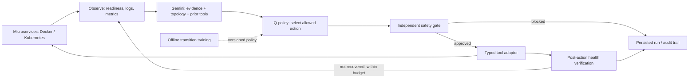

# Quasar

An implemented **agentic microservice debugging framework** using **Gemini**, **LangGraph**, and an **offline tabular Q-learning policy**. Includes a CLI, a local-demo API, persisted audit trails, and explicit Docker/Kubernetes adapters.

This is framework code, not the SDV architecture in the supplied reference PDF. It does not use OpenAI.

## Quick start

```bash
pnpm install

# Real HTTP gateway/worker traffic, synthetic faults, explicitly non-LLM diagnosis:
pnpm quasar demo --fault crash --offline --apply

# Same local harness, but with real Gemini diagnosis:
pnpm quasar demo --fault crash --apply

# Default mode diagnoses and proposes; it does NOT modify even the demo:
pnpm quasar demo --fault crash --offline

# Rollback is separately gated:
pnpm quasar demo --fault regression --apply --allow-rollback

# Other local faults:
pnpm quasar demo --fault resource --offline --apply
pnpm quasar demo --fault dependency --offline --apply
```

Gemini runs require `GEMINI_API_KEY` in the secret environment. No key belongs in a file, CLI argument, request body, or log. `QUASAR_GEMINI_MODEL` optionally changes the model; the default is `gemini-2.5-flash`. Failures are reported explicitly: there is **no silent fallback to offline reasoning**.

The harness opens temporary loopback HTTP servers and closes them when the run finishes. Its faults and CPU/memory signals are synthetic; its HTTP status checks and latency measurements are real. It is not a Docker or Kubernetes cluster.

## Architecture



LangGraph implements `observe → diagnose → select → gate → execute → verify`. Inspection results become bounded tool evidence for subsequent Gemini reasoning. The service dependency graph is part of incident state, not an RTOS/static execution scheduler. Microservice dependencies may contain cycles.

### Modules

| File | Responsibility |
| --- | --- |
| `lib/quasar/src/contracts.ts` | Validated telemetry, diagnosis, actions and adapter interfaces |
| `lib/quasar/src/agent.ts` | LangGraph state machine, stop conditions and recovery verification |
| `lib/quasar/src/reasoners.ts` | Gemini diagnosis with retry/backoff and explicit offline reasoning |
| `lib/quasar/src/policy.ts` | Offline Q-learning, policy validation, action masking and evaluation |
| `lib/quasar/src/safety.ts` | Independent target, permission, confidence and mutation checks |
| `lib/quasar/src/adapters.ts` | Allowlisted Docker/kubectl tools and read-only snapshot intake |
| `lib/quasar/src/harness.ts` | Runnable two-service HTTP fault lab and synthetic training transitions |
| `lib/quasar/src/store.ts` | Atomic policy/run persistence and JSONL loading |
| `scripts/src/quasar.ts` | CLI for demos, real runs, monitoring, training and evaluation |
| `artifacts/api-server/src/routes/quasar.ts` | Local-demo-only HTTP API |

## Train and evaluate an RL policy

```bash
pnpm quasar dataset
pnpm quasar train --dataset examples/synthetic-transitions.jsonl --epochs 200 --seed 42
pnpm quasar evaluate --dataset examples/synthetic-transitions.jsonl
```

Training really updates a Q-table using:

```text
Q(s,a) = Q(s,a) + alpha * (reward + gamma * max(Q(s',a')) - Q(s,a))
```

The state abstraction is `diagnosed cause | worst observed health`. Default `alpha=0.15`, `gamma=0.9`. Epoch shuffling is seeded. At inference, only adapter-supported actions are considered; unseen states choose inspection. Training is offline: live incidents do not silently change the deployed policy.

This is a transparent tabular baseline, **not PPO, deep RL, or a trained LLM**. The tiny synthetic dataset demonstrates wiring and is not evidence of production generalization.

### Bring your own dataset / LO2

`train` accepts normalized JSONL transitions, one object per line:

```json
{
  "state": { "observedAt": "2026-10-04T12:00:00.000Z", "source": "your-dataset", "services": [] },
  "cause": "crash",
  "action": "restart",
  "reward": 10,
  "nextState": { "observedAt": "2026-10-04T12:01:00.000Z", "source": "your-dataset", "services": [] },
  "nextCause": "healthy",
  "terminal": true
}
```

The empty arrays above are placeholders illustrating the shape; real rows must contain at least one complete service as shown in `examples/incident.json`. Cause values are `healthy`, `crash`, `resource`, `regression`, `dependency`, `unknown`; actions are `inspect`, `restart`, `scale`, `rollback`, `escalate`. Unknown metrics must be `null`, not zero. Service fields are validated by `SnapshotSchema`.

For the official LO2v2 per-test JSON metrics layout, Quasar includes a separate,
offline value-only pilot benchmark. It reads CPU and memory files from the archive
without extracting its contents:

```bash
pnpm quasar lo2-benchmark \
  --dataset /path/to/light-oauth2-metrics.zip \
  --out .local/quasar/lo2v2-benchmark.json
```

The checked public example is `light-oauth2-metrics.zip` from Zenodo record
[10.5281/zenodo.18937117](https://zenodo.org/records/18937117), licensed
CC-BY-4.0. The benchmark labels the `correct` test as control and every other
named test as a deliberately error-triggering task. It calibrates a robust
median/MAD outlier baseline on the first 60% of the control test's time points,
then reports test-level precision, recall, specificity, F1 and balanced
accuracy from CPU-core rate and container working-set memory.

This is only an **error-test identification pilot**, not a general outage
detector: the public reproduction package contains one example run, and the
normal holdout comes from the same `correct` task. The directory labels do not
mean that infrastructure failures occurred. This benchmark does not evaluate
root-cause diagnosis, remediation, or the Q-learning policy. LO2v2 does not
provide action/reward/intervention trajectories, so do not describe these
metrics as treatment effectiveness or debugging-time improvement.

On the checked one-run example (54 test directories: 53 error-triggering and
one control), the initial 3.5-MAD / 10% threshold predicted all 54 tests as
positive: precision 0.9815, recall 1.0, specificity 0, and balanced accuracy
0.5. The high ordinary accuracy is an imbalance artifact; this baseline did
not distinguish the control from the error-triggering tasks.

The existing `train` and `evaluate` commands still require normalized
action/reward transitions. They report one-step logged-transition rewards and
resolution rates against a seeded random action baseline, not LO2 anomaly
detection. Do not train or evaluate the remediation policy on anomaly labels.

## Vercel and Render deployment

The root `vercel.json` builds the Quasar Console as a static Vite SPA. Set
`VITE_API_BASE_URL` in the Vercel project's production build environment to the
Render service's origin only (for example, `https://service-name.onrender.com`,
with no `/api` suffix). Set the Vercel project's Root Directory to the
repository root so it can use the workspace lockfile and root deployment
configuration. The build intentionally fails when this value is missing so a
frontend cannot silently deploy with its API pointed at itself.

The root `render.yaml` defines a **free, offline-demo-only** Node web service
with `/api/healthz` as its health check. It does not enable Gemini or live
infrastructure access. Render's free web services spin down when idle and have
ephemeral filesystems; the demo audit history stored locally will be lost on
spin-down, restart, or redeploy. This setup is for preview/testing, not durable
production history.

## Diagnose collected telemetry without touching infrastructure

```bash
pnpm quasar run --adapter snapshot --input examples/incident.json \
  --targets worker,gateway --topology examples/topology.json \
  --policy .local/quasar/policy.json
```

This invokes Gemini unless `--offline` is supplied. Snapshot mode refuses `--apply`, cannot confirm live recovery, and returns a proposed remediation instead. An optional topology JSON file maps service names to dependency names.

## Docker and Kubernetes

These adapters invoke installed `docker` / `kubectl` binaries with **argument arrays, never a shell**. They operate only on the names the operator supplies. They use the operator's existing Docker context / kubeconfig; this repository does not store those credentials.

Docker/container execution is not available inside this Replit runtime. Run the live CLI on a host that already has the required tool and access to your environment. Replit can run the HTTP harness and snapshot diagnosis.

```bash
# Observe only. Docker supports inspect, restart and escalation.
pnpm quasar run --adapter docker --targets worker \
  --policy .local/quasar/policy.json

# Opt in to one allowlisted container restart if selected.
pnpm quasar run --adapter docker --targets worker --apply

# Explicit namespace is mandatory; no default cluster namespace is assumed.
pnpm quasar run --adapter kubernetes --namespace staging --targets worker,gateway \
  --topology examples/topology.json --policy .local/quasar/policy.json

# Bounded permitted mutations; scaling increases by one, never above the cap.
pnpm quasar run --adapter kubernetes --namespace staging --targets worker \
  --apply --max-replicas 3 --max-mutations 1

# Rollback requires a second explicit permission.
pnpm quasar run --adapter kubernetes --namespace staging --targets worker \
  --apply --allow-rollback

# Poll readiness and automatically start debugging when unhealthy.
pnpm quasar monitor --adapter kubernetes --namespace staging --targets worker \
  --poll-seconds 15 --max-incidents 5
```

Monitoring stops after the incident cap, on an unresolved/proposed/failed incident, or on Ctrl-C. It does not keep applying changes to an unresolved incident.

### Safety defaults and limits

- Observe-only by default; `--apply` is operator authorization, not an LLM decision.
- Rollback needs `--allow-rollback` as well.
- Default confidence threshold 0.7, maximum two mutations and six decisions per incident.
- Exact target allowlists; maximum 20 targets.
- No arbitrary shell, deletion, pod exec, secret inspection or free-form commands.
- Kubernetes scales upward by one, with a default cap of five; rollout completion and generation are verified.
- Docker requires a defined container healthcheck to claim healthy recovery. Merely running is not enough.
- Readiness is a limited health signal, **not proof that all application SLOs recovered**. Docker/Kubernetes adapters currently do not ingest tracing or a Prometheus backend; metrics absent from runtime snapshots remain `null`.
- Logs are redacted for common key/token/password patterns before model input and persistence. This is not a complete DLP guarantee; sanitize sensitive telemetry at its source.
- Use least-privilege Docker/Kubernetes access in a staging environment first. The synthetic policy should not be assumed safe or effective for production.

## Local-demo API

The running API is under `/api`:

```bash
curl <project-preview-url>/api/quasar/status
curl -X POST <project-preview-url>/api/quasar/demo \
  -H 'Content-Type: application/json' \
  -d '{"fault":"crash","apply":true}'
curl <project-preview-url>/api/quasar/runs
curl <project-preview-url>/api/quasar/runs/<uuid>
```

The API deliberately exposes **only synthetic local demos with the offline reasoner**. It cannot call paid Gemini, inspect live infrastructure, or read the live CLI audit store. At most two local runs execute concurrently. Live operations belong in the trusted CLI until authenticated operator access is added.

CLI runs/policies are stored under `.local/quasar/`; API demos use a separate `api-runs` directory. These files are ignored by Git. File-backed audit storage persists across local restarts, but it is not a production durable database.

```bash
pnpm quasar runs
pnpm quasar runs --id <uuid>
pnpm run typecheck
```